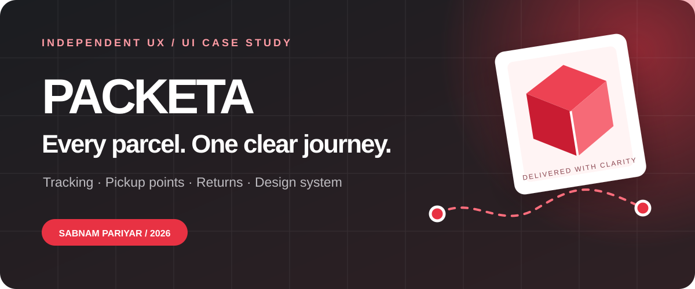

# PACKETA — Every parcel. One clear journey.

*Explore the delivery experience, then switch to the interactive design system, moodboard and design process.*

*An independent product UX/UI case study by Sabnam Pariyar.*

I designed this Packeta concept to explore a familiar everyday moment: a parcel is on its way, someone wants to know when it will arrive, and the next step should feel obvious rather than uncertain.

This responsive prototype brings parcel tracking, pickup-point selection and returns into one calm experience. It is a speculative exploration using fictional sample parcels, not an official Packeta product.

## Explore the experience

The prototype is at the centre of the project. Select a shipment, simulate a status change, compare illustrative Prague pickup locations, or try the simple return flow. Continue into the **Design system** and **Moodboard** to see the thinking behind the interface.

### The design challenge

Delivery interfaces must make complex logistics understandable. My design question was: **how can people feel informed and in control between checkout and collection?**

I approached the problem through four principles:

- **Clarity:** show where a parcel is and what its current status means.
- **Confidence:** pair important updates with an obvious next action.
- **Choice:** help people compare collection options at a glance.
- **Consistency:** use a shared visual language across tracking, pickup and returns.

## What you can try

1. Open **PK-482901** to follow an in-transit parcel.
2. Select **Simulate update** and see its status and timeline change.
3. Switch to **PK-582470** to explore a parcel ready for collection.
4. Choose among three fictional pickup locations and save a preference.
5. Search a tracking number, try **Return item**, and inspect the sample pickup code.
6. Open the **Design system** to explore colors, type, components and interactive states.
7. Visit the **Moodboard** and **Design process** to see visual references and the project rationale.

The demonstration uses fictional shipment data and an illustrative map. It is designed for exploration, not real package management.

## Behind the design

I included the design thinking inside the experience itself. The moodboard connects packaging materials, architecture and everyday movement to the visual direction. The design system shows the color tokens, typography, spacing, status treatments, buttons and cards used across the prototype.

For a deeper view, read the [UX case study](docs/UX-CASE-STUDY.md) and [visual design system](docs/DESIGN-SYSTEM.md).

## Scope and honesty

Packeta is a real logistics company; this concept is **self-initiated and independent**, not commissioned, approved or endorsed by Packeta. The parcels, collection points, pickup codes and status updates are invented. The moodboard uses external photographic references. No user interviews, task-performance improvements or business results are claimed as validated.

---

**Sabnam Pariyar** · UX / Product Design · Finland

